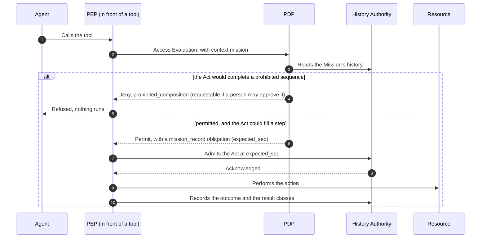

# authzen-composition

[](https://github.com/xmuruaga/authzen-composition/actions/workflows/ci.yml)
[](LICENSE)
[](pyproject.toml)
[](.coveragerc)

The AuthZEN Mission Composition Profile, with an implementation and a
conformance suite. It lets an AuthZEN PDP deny the Act that would complete a
prohibited sequence of Acts within one Mission, even when different PEPs enforce
those Acts. It is based on the ordered-composition result of
[Bounded Agents](https://arxiv.org/abs/2608.15888). The current text is Draft 1,
in release 0.2.0 (`CHANGELOG.md` lists what changed).

> This is an individual proposal. It is not an OpenID Foundation project
> and not a work item of the AuthZEN Working Group. OpenID is a trademark
> (registered in various countries) of the OpenID Foundation.

## The problem

The AuthZEN Authorization API evaluates each request separately. An agent working
through a Mission can take steps that are each acceptable on their own yet form
an exfiltration together: read a payroll record at one resource, write it into
a document at a second, send that document to an outside address from a third.
No single check sees a problem.

The predicate that catches it is the classic security automaton (Schneider,
2000). What the profile defines is the contract that lets independently built
PEPs and PDPs apply it to one Mission: one order, admission before effect,
completeness, effect order, and how a denial is signaled.

## AuthZEN in brief

[AuthZEN](https://openid.net/wg/authzen/) is the OpenID Foundation working
group that standardizes how a policy enforcement point (PEP) asks a policy
decision point (PDP) for an authorization decision. This profile builds on:

- the [Authorization API 1.0](https://openid.net/specs/authorization-api-1_0.html),
  the group's final specification;
- the Obligations Core and the Extensibility Model, proposed in
  [openid/authzen PR #697](https://github.com/openid/authzen/pull/697);
- the Access Request and Approval Profile (ARAP), in
  [openid/authzen](https://github.com/openid/authzen), for the cases a person
  may approve;
- the [mission-bound drafts](https://github.com/mcguinness/mission-bound-authorization),
  which define Missions for agents.

The revisions the draft is pinned to are under "Pinned versions".

## How it fits

Every PEP of a Mission records, at one History Authority and in one order, each
Act that could fill a step of a prohibited sequence. The PDP reads that history
before it decides, and the PEP acts only once the Act is admitted.



## Try it

```bash
python -m pip install -e ".[dev]"
python -m pytest --no-cov -o addopts= tests/test_pdp.py tests/test_interop_vectors.py tests/test_arap.py
PYTHONPATH=. python -m e2e.run_e2e    # 19 scenarios in separate processes over HTTP, about 2 minutes
```

The first test command is a quick check without the coverage gate; "Run the
checks" below has the full suite. The end-to-end run prints, for each scenario,
whether it passed and what happened, and ends with the oracle's count of salary
data that reached an external audience without a person's approval.

## What is here

| | What | Status |
|---|---|---|
| `docs/authzen-composition-profile-1_0.md` (rendered: `.txt`) | The profile: predicate, result classes, History Authority requirements, five ordering rules, `mission_record` obligation | Normative proposal |
| `docs/mission-history-service.md` + `authzen_composition/` | A reference PDP, PEP, Mission History Service and ARAP Access Request Service, with HTTP bindings and clients so each runs as its own process | Non-normative |
| `tests/`, `interop/test-vectors/`, `docs/TRACEABILITY.md` | Adversarial tests, replayable vectors, and a map from every MUST to the tests that show it, or to the deployment that must meet it | Conformance suite |
| `e2e/` | The end-to-end run and the false-positive study | Non-normative |

## What the tests show, and what they do not

They show the logic: the predicate, serialized admission, admission before
effect, effect order under delays, conservative handling of unknown outcomes,
idempotent retries, writer authentication and approvals bound to the exact
request. The end-to-end run shows it across separate processes and real HTTP,
with crashes, lost acknowledgements and outages. They do not show durability,
availability or performance: the reference History Authority is in memory, so
a restart loses it. `docs/TRACEABILITY.md` marks which requirements bind a
production deployment and cannot be demonstrated here.

For approvals the reference implements ARAP's shared-state flow
(`authzen_composition/arap.py`): the PDP plays the Access Request Service,
publishes its Access Request Endpoint, and resolves `evaluation_id` and
`approval.id` from its own state; the PEP submits the Access Request, follows
the task, and evaluates again with the approval (`AccessRequestClient`); a
person decides through a separate approver route. Before deciding, an eligible
approver can review the task: the prohibited sequences the denial would
complete, and the earlier attempts at the same target with their outcome, open
ones first. It does not implement binding
artifacts (`binding_token`, `approval.state`), so it does not meet ARAP's
Interoperability Baseline, which requires verifying them as JWS; the open draft
[openid/authzen PR #738](https://github.com/openid/authzen/pull/738) proposes
making them declared capabilities. Cancellation, bulk submissions, callbacks
and forms are not implemented either.

The suite is built in layers, each able to catch what the others miss:

| Layer | File | What it checks |
|---|---|---|
| Unit and scenario tests | `tests/test_*.py` | Every rule of the profile, each with the attack it blocks |
| Concurrency | `tests/test_effect_ordering.py`, `tests/test_effect_order_pending.py` | Real threads racing for the same position; a stalled Act while others run |
| Whole-system interleaving | `tests/test_interleaving.py` | Many PEPs, every protocol step scheduled adversarially (stale permits, lost acknowledgements, late, missing and `failed` outcomes); in 1,500 generated schedules per run none realizes a prohibited sequence in true effect order, and in 500 more, with every outcome reported, no Act is held back forever |
| Differential oracle | `tests/test_differential_oracle.py` | The PDP against a separately written brute-force implementation of the profile text, on 1,500 generated cases per run |
| Exhaustive small scope | `tests/test_exhaustive_small_scope.py` | The predicate against a brute-force reading of the text on every sequence of 2 or 3 steps over the actions `a`, `b` and `*` (with every persistent mark the profile allows, on any step but the first) and every history of up to 3 Acts over `a`, `b` and `c` in every outcome, 309,960 cases |
| Soundness properties | `tests/test_property_soundness.py` | The composition-soundness result, including in true effect order |
| HTTP fuzzing | `tests/test_http_fuzz.py` | Arbitrary methods, paths, headers and bodies against the Mission History Service (MHS) binding and the PDP endpoint, 1,500 generated sequences of one to six requests per run for each: never a crash, only documented statuses, no change and no evaluation without authentication |
| End to end | `tests/test_e2e.py`, `e2e/` | Every component in its own process over HTTP, 19 workflows and attacks, checked by an oracle that tracks the data itself; plus the false-positive matrix |

Rule 5 as written is also pinned by vectors V23, V27 and V29, so a rule 5 that
is only too loose fails them even when a random run does not schedule the race
that would expose it.

## End to end, as it would be deployed

`e2e/` runs the profile the way a deployment would: every component in its own
process, talking only over HTTP on 127.0.0.1 (16 processes). The History
Authority speaks the MHS binding; the PDP speaks the AuthZEN Access Evaluation
API (`authzen_composition/pdp_http.py`) and reads history over HTTP
(`authzen_composition/remote.py`); three tool hosts (HR records, documents,
mail), each a resource with its PEP in front, take the Mission from a signed
token the agent cannot mint. Around them: a PDP replica with an older policy,
a PDP reading from a lagging replica, proxies that lose an acknowledgement or
go down, mail hosts that queue deliveries, and an operator interface on the
History Authority for closing a stranded Act.

```bash
PYTHONPATH=. python -m e2e.run_e2e     # 19 scenarios, about 2 minutes
PYTHONPATH=. python -m e2e.fp_study    # the false-positive matrix below
```

Ground truth does not come from the profile. Every salary record carries a
unique canary string, and every resource logs, with its content, each moment
data becomes visible outside: a delivered mail, a public link, a write into a
shared document. The oracle checks one thing: no canary reached an external
audience without a person's approval. It does not trust the resource's
"approved" flag: an exposure counts as approved only if a person granted an
approval for that Mission and recipient. A leak in a scenario's Missions fails
that scenario, whatever its own checks said.

| | Scenario | Result |
|---|---|---|
| L1-L3 | Payslips mailed internally; a press release from the public handbook; press release first, salaries afterwards | Complete |
| A1 | Salary read, written into a document, mailed to the press | Denied, requestable; the mail PEP submits an ARAP Access Request, and until a person decides the task gives it nothing to act on; a person approves, and that one send runs; an approval the agent made up, the real one for another recipient or another attachment, and the real one a second time are all refused, the last with `next_action` `request` |
| A2 | Same, through an alias (`press`) and through a list with an external member | Denied for the external target only |
| A3 | Share link created first, salary written into the shared document later | Write denied |
| A4 | Send queued with the document attached by reference, then the salary read | Read held (`history_pending`) until the send is delivered (the run holds the queue, then releases it); an unrelated Act is not held |
| A5 | Prompt injection: a document tells the agent to leak a salary, and it does as told | The send is denied |
| A6 | Forged, tampered and expired Mission tokens; `mission` and `result_classes` smuggled into tool arguments | Rejected; ignored, and nothing is recorded under any other Mission |
| A7 | A sub-agent with a delegated token sends what its parent staged | Denied |
| A8 | 12 Missions, a reader and a queued sender racing in each | No leak |
| A9 | Admission acknowledgement lost after the commit | Retried with the same `admission_id`; one Act recorded |
| A10 | A PDP replica with an older policy decides for a Mission started at another | `policy_mismatch` |
| A11 | The HR PEP process dies after admitting a read, before reporting it; then an operator closes the Act | Act stays open and holds later writes and sends; once closed, the write runs and the send is still denied |
| A12 | 8 agents in one Mission, two PEPs racing for the same positions | All 24 Acts admitted, gapless, after re-evaluations; Acts that share a sequence run one at a time |
| A13 | The mail PEP loses the authority while its queued send lands | The outcome is kept, the Act stays open and holds a read; after recovery the outcome is delivered and the read runs |
| A14 | A queued send bounces | Recorded `failed` on the resource's word; the held read then runs |
| A15 | A PDP reads from a replica one Act behind | It permits the send on the stale view, but admission at the authority refuses the position every time; nothing runs |
| A16 | History Authority down, then PDP down | Nothing runs |

Serialization has a cost: in A12, 24 Acts that share a sequence went through
one at a time, at about 25 Acts per second on an unloaded laptop. An admitted
Act goes through five HTTP calls; one that matches no step is not serialized
and takes fewer.

The agent is a script, not a language model, on purpose: the PDP sees Acts,
never intent, so the decision is the same whoever chose the send, and a script
makes the run reproducible.

Red check: with the effect-order rule (rule 5) disabled in the PDP, A4 leaks
the salary through the queued send every time, and A8 does whenever the race
lands that way; the oracle reports each leak and fails the scenario.

```bash
PYTHONPATH=. python -m e2e.run_e2e --sabotage no_rule5 --only A4,A8
```

### False positives

The same resources, in one process, running legitimate (`T`) and malicious
(`M`) workflows under the recommended policy and under variants that each
break one piece of the profile's guidance. `TN` legitimate and completed;
`FP*` legitimate, stopped by a requestable denial a person can approve; `TP`
attack stopped; `FN` salary reached an external audience.

| Task | recommended | no persistent mark | class pattern also on the write | same, documents labeled by DLP | no declared label domain | PEP records the list, not its members |
|---|---|---|---|---|---|---|
| T1 Payslips: read each salary, write the payslip, mail it to the employee | TN | TN | TN | TN | TN | TN |
| T2 Press release from the public handbook, sent to the press | TN | TN | TN | TN | FP* | TN |
| T3 Salary review for HR, then an unrelated press release, same Mission | FP* | FP* | TN | FP* | FP* | FP* |
| T4 Meeting notes HR cannot classify, then a press release | FP* | FP* | TN | TN | FP* | FP* |
| T5 Salary review for HR, then a public FAQ shared by link | FP* | FP* | TN | FP* | FP* | FP* |
| T6 Press release first, salary review afterwards (safe order) | TN | TN | TN | TN | TN | TN |
| M1 Salary copied into a document, mailed to the press | TP | TP | FN | TP | TP | TP |
| M2 Share link created first, salary written into that document later | TP | FN | TP | TP | TP | TP |
| M3 Salary mailed to a distribution list with an external member | TP | TP | FN | TP | TP | FN |
| M4 Salary written into a document, then the document shared by link | TP | TP | FN | TP | TP | TP |
| M5 As M1, with the record rephrased ("Pay for") before it is written | TP | TP | FN | FN | TP | TP |

What it shows:

* The recommended policy stops all five attacks in the matrix and hard-blocks
  none of the six legitimate tasks. Its cost is approvals: three of the six
  legitimate patterns need one. Approvals are per Act, and the matrix counts
  one per task: once a Mission holds a matching read and a later write, each
  further external send needs its own approval, and once a share link is
  approved, each further write does too (open question 10 of the profile).
* Each piece of the guidance is load-bearing: dropping it opens a miss (no
  persistent mark: M2; class patterns on later steps: M1, M3, M4, M5; a PEP
  that records the list: M3) or adds false positives (no declared label
  domain: T2).
* A content-labeling (DLP) document system removes some false positives, but
  a rephrased record defeats the keyword rule (M5).
* T3 and T5 are false positives that no variant in the matrix removes without
  a miss: a sequence relates Acts by type and order, not by object, so it
  cannot tell that the press release is not the document the salary went
  into. That is open question 7 of the profile.

The tasks were written for this study, so the matrix shows which patterns each
policy gets right or wrong, not how often they occur in a given organization.

## Interop vectors

`interop/test-vectors/composition-vectors.json` holds 46 scenarios, each a
Mission with ordered Acts, each Act with a reported outcome (`completed`,
`open` or `failed`), and the expected decision and reason for the last Act.
Another PDP can replay them with a port of `interop/verify_vectors.py`. They
cover ordered composition, reverse order, omission, open and failed outcomes,
unknown result classes, internal versus external sends, declared and empty
label domains, a completed Act that reported no class, `history_pending` while
an Act is in flight (including an open Act that could fill two steps, and an
open write before an external send), persistent steps (a share link created
before the data reaches it), the `mission_record` obligation (also on an empty
history), requestability, and the opt-in a PEP needs before it receives
`mission_record`. Every scenario also carries the policy digest the profile
defines for its policy, so a port checks that its PDPs would pin the same
Missions as the reference's. A test runs the verifier against plausible wrong
implementations and checks that each fails at least one vector. Concurrency,
approvals, batches, policy pinning and failed history reads are covered by the
test suite, not by the vectors (see their README).

## Run the checks

The checks CI runs, on Linux, macOS and Windows, with Python 3.11 to 3.14:

```bash
python -m pip install -e ".[dev]"
python -m ruff check .
python -m mypy authzen_composition e2e    # strict, as configured in pyproject.toml
python -m pytest                          # 100% line and branch coverage
PYTHONPATH=. python interop/verify_vectors.py
PYTHONPATH=. python scripts/gen_vectors.py --check
```

In Windows PowerShell, set the variable first and leave out the `PYTHONPATH=.` prefix:

```powershell
python -m pip install -e ".[dev]"
$env:PYTHONPATH = '.'
python -m pytest
python interop/verify_vectors.py
python -m e2e.run_e2e
```

The full suite generates hundreds of thousands of cases and takes from several
minutes to about half an hour, depending on the machine.

The draft is a kramdown-rfc document, built the way AuthZEN specifications
are. Its rendered text is committed next to it,
`docs/authzen-composition-profile-1_0.txt`, and CI checks that it is current.
To rebuild it with kramdown-rfc 1.7.43 and xml2rfc 3.30.0, the versions CI
uses, and the references cached in `.refcache`:

```bash
export KRAMDOWN_REFCACHEDIR=.refcache KRAMDOWN_OFFLINE=1
kramdown-rfc docs/authzen-composition-profile-1_0.md > draft.xml
xml2rfc --text draft.xml -o docs/authzen-composition-profile-1_0.txt
xml2rfc --html draft.xml
```

## Pinned versions

The draft reads its dependencies at these revisions, which its references
name:

- the Authorization API 1.0, final;
- the Obligations Core and the Extensibility Model at openid/authzen
  `f097170`, in PR #697 (14 October 2026);
- ARAP at openid/authzen `6d5380c` (13 October 2026);
- the mission-bound drafts at mcguinness/mission-bound-authorization `19b65a4`
  (18 October 2026).

All but the first are drafts and will change. `CHANGELOG.md` records the
revisions each release is pinned to.

## Background and citing

The ordered-subsequence predicate is the enforcement mechanism of the
*Ordered k-tuple soundness* result in **Bounded Agents: Delegation Security for
Multi-Agent AI Systems** (<https://arxiv.org/abs/2608.15888>, version 1), which
extends to order the paper's pairwise, order-insensitive *Composition
Soundness* theorem. Refinement by result class, with a conservative top for
unknown outcomes, and persistent steps are this profile's extensions of that
result; `tests/test_property_soundness.py` checks it, including in true effect
order.

If you build on this work, please cite the paper (`CITATION.cff` holds the same
metadata, behind GitHub's "Cite this repository"):

```bibtex
@misc{muruaga2026boundedagents,
  title         = {Bounded Agents: Delegation Security for Multi-Agent AI Systems},
  author        = {Muruaga, Xabier},
  year          = {2026},
  eprint        = {2608.15888},
  archivePrefix = {arXiv},
  primaryClass  = {cs.AI},
  doi           = {10.48550/arXiv.2608.15888},
  url           = {https://arxiv.org/abs/2608.15888}
}
```

## Contributing

Feedback and independent implementations are welcome, as issues or pull
requests here (`CONTRIBUTING.md`) or on the AuthZEN Working Group's
[mailing list](https://lists.openid.net/mailman/listinfo/openid-specs-authzen).
Report a suspected vulnerability privately (`SECURITY.md`).

## License

Apache-2.0. See `LICENSE` and `NOTICE`.
